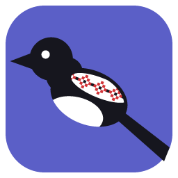
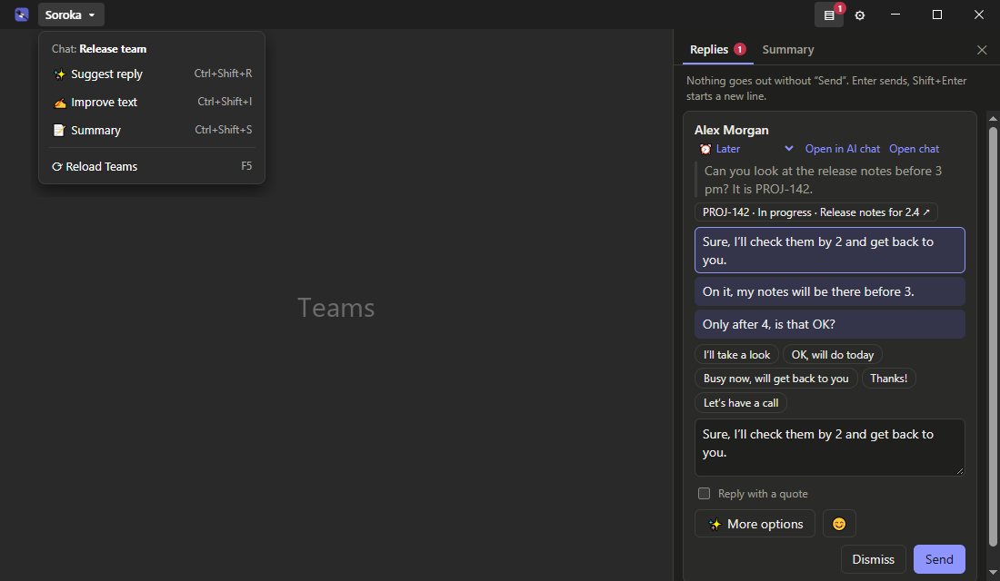
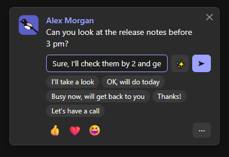
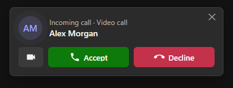
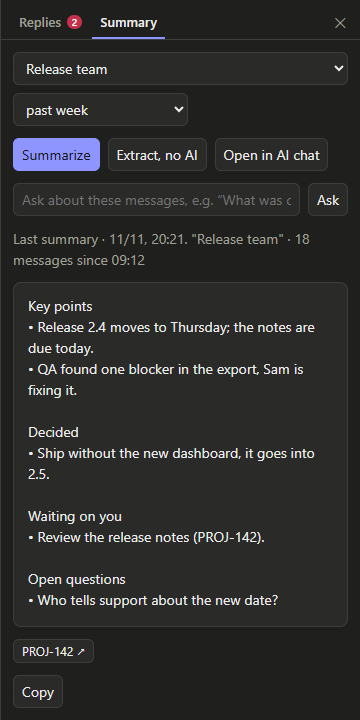
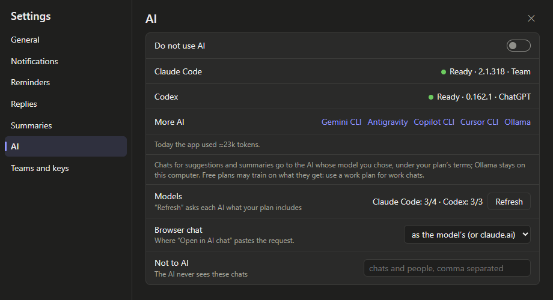

<p align="center"></p>

<h1 align="center">Soroka</h1>

<p align="center"><b>English</b> · <a href="README.uk.md">Українська</a></p>

Soroka is a Windows tray app for Microsoft Teams (work or school accounts). It runs Teams on the web inside its own window, which can stay hidden. It brings personal messages, @mentions and calls to small cards in the corner of the screen, and lets you reply, react or get a summary from the card without opening Teams.

Replies and summaries can be written by the AI of the subscription you already pay for: Claude Code, Codex (ChatGPT), Gemini CLI and others. There are no API keys and no extra bills. Nothing is ever sent without your click.

> Soroka is an independent project. It is not affiliated with, endorsed by or supported by Microsoft. It works with the Teams web app as it looks today, so a Teams update can break parts of it until Soroka is updated.

<p align="center"></p>

Soroka's window is Teams with a title bar of its own. «Soroka ▾» holds the actions for the chat you have open: suggest a reply, improve your text, a summary, reload Teams. ▤ opens the Replies panel on the right, and ⚙ opens the settings. (Teams itself is left out of the picture.)

<p align="center">
  
  
</p>

## Features

**Notifications**
- Cards for personal messages, @mentions and keywords, also in group chats. Mentions in channels come from Teams' Activity feed.
- Filters: «Only from», «Never from» and quiet hours. Messages that arrive in quiet hours are announced when the quiet hours end.
- Reminders. A message that is still unanswered comes back after a set time, and a question of yours that got no reply can be followed up in one click.
- Optionally, the AI sorts incoming messages. What needs you comes at once; the rest comes as one card an hour.

**Replying from a card**
- Reply right in the card. Quick phrases and Teams' quick reactions 👍 ❤️ 😆 are on the card; the full Teams reaction set is in its ⋯ menu.
- ✨ asks the AI for reply variants, and pressing it again shows the next one. Type what the reply should say ("decline politely, I'll do it tomorrow") before ✨ and every variant follows it.
- The «Replies» panel next to Teams keeps every card in one place. Cards can be snoozed (30 min, 1 h, 3 h, tomorrow) or sent with a quote.
- «Improve my text» rewrites what you typed in Teams: fixed, shorter, politer or translated.
- Messages the AI wrote can carry a 🤖 mark. Your own words never get one.

**Summaries**
- A summary of one chat for a chosen period, of several chats at once, «What I missed» or the daily digest. You can also ask a question about a chat instead.
- «Extract, no AI» works without any AI: it lists what waits for you, tasks, links, files, dates and who wrote.

<p align="center"></p>

**Calls**
- An incoming call or a started meeting shows a card at the top right with Teams' own buttons.
- A call opens in its own window, as in the Teams app. Screen sharing has a picker of screens and windows.
- Minimize the call window and a small one stays on top, as Teams' compact view: microphone, camera, hand, people and leave, who is speaking and how many are in. Like Teams, both windows stay out of screenshots.

**Jira** (Server / Data Center)
- Ticket keys and links in chats and cards show the ticket's status and name.
- A personal access token is kept encrypted by Windows (DPAPI) and sent only to the Jira it was saved for.

**Comfort**
- Interface in Ukrainian, English and Russian. When you pick Soroka's language or theme, Teams switches to it too, once; a later change in Teams itself stays.
- Hotkeys in the Teams window: Ctrl+Shift+R suggest a reply, Ctrl+Shift+S summary, Ctrl+Shift+I improve my text, F5 reload Teams.
- When hidden, Soroka gives its memory back to Windows (about 250 MB instead of 1.5 GB).
- A new version comes as a card: «Install» downloads it from the Releases page, checks the author's signature and Soroka restarts as the new one.

## AI: your own plan, no API keys

Soroka finds the AI programs installed on your computer and uses the plan you are signed in with:

| Program | Plan |
|---|---|
| Claude Code (also the one inside Claude Desktop) | Claude |
| Codex CLI | ChatGPT |
| Gemini CLI | Google |
| GitHub Copilot CLI | GitHub Copilot |
| Cursor CLI (`cursor-agent`) | Cursor |
| Antigravity | Google |
| Ollama | none, runs on your computer |

«Refresh» in Settings → AI asks each program which models your plan includes. You choose one model for replies and one for summaries. If a model hits its limit, the next ready one answers.

Live-tested: Claude Code and Codex. The others follow their documentation.

<p align="center"></p>

Without any AI, Soroka still notifies, lets you reply by hand and makes the extract without AI. «Do not use AI» in the settings turns AI off completely.

## Privacy and safety

- **Nothing is sent without your click.** That covers cards, the panel and requests from AI sessions on your computer (see the local API below).
- **Where your chats go.** The text of a chat goes only to the AI whose model you chose, under your plan's terms. Ollama keeps it on your computer. Free plans may train on what they get, so use a work plan for work chats.
- **«Not to AI».** Chats and people on this list never reach the AI. Their messages are also cut out of other chats' transcripts.
- **No tools for background AI.** What Soroka asks the AI on its own (reply variants made ahead for new messages, AI sorting, the daily digest) goes only to an AI without tools: Claude, Codex with its tools switched off, or Ollama when you picked it. A message in a chat cannot make the AI run commands, read files or open sites. Gemini, Antigravity, Copilot and Cursor have tools of their own: they answer only on your click, and see chats only after you allow it once.
- **Your data stays local.** Your Teams session, settings and the local API token live in `%APPDATA%\Soroka`. Soroka has no server of its own and sends no telemetry. Once a day it asks GitHub whether a newer version is out; that request carries nothing about you.
- **The local API is local only.** It listens on `127.0.0.1` and needs the token. It turns away requests from browser pages.

## Requirements

- Windows 10 or 11, x64. Other systems are not tested.
- A Microsoft Teams account for work or school.
- Optionally, one of the AI programs above, signed in with its plan.

## Install

1. Download `Soroka-Setup-<version>.exe` from the Releases page, or build it from source (below).
2. Run it. It installs for the current user, without admin rights. The installer is not code-signed, so Windows SmartScreen may warn: choose «More info» → «Run anyway».
3. Sign in to Teams in the window that opens. Soroka then sits in the tray. Open the settings from the tray icon or with ⚙ in the window's title bar.

## Build from source

```bash
npm ci
npm start          # run from source
npm run dist       # build release/Soroka-Setup-<version>.exe
```

`release/Soroka-Setup-<version>.exe /S` installs silently.

If you run it from a terminal inside VS Code, remove `ELECTRON_RUN_AS_NODE` first. VS Code sets it, and with it Electron starts as plain Node.

Releases are built by GitHub Actions: push a tag `vX.Y.Z` that matches the version in `package.json`, and [the release workflow](.github/workflows/release.yml) builds the installer and publishes it on the Releases page. It also signs the installer for the update check with the secret `UPDATE_SIGNING_KEY` of the environment `release` and publishes `Soroka-Setup-X.Y.Z.exe.sig` next to it. Installed copies offer an update only with that signature, and never run an installer whose signature does not match.

## Local API for AI sessions

Soroka serves an API on `127.0.0.1:8765` for AI sessions on your computer, such as Claude Code. Every request and every answer is signed with the token in `%APPDATA%\Soroka\token.txt` (HMAC-SHA256); the token itself is never sent. `tb.mjs` wraps it:

```bash
node tb.mjs chats                         # the chat list: * unread, @ mention
node tb.mjs unread                        # unread personal chats and mentions
node tb.mjs read "<chat>" [n]             # the last n messages
node tb.mjs summary "<chat>" [n] [plain]  # a summary; plain: without AI
node tb.mjs draft "<chat>" "<text>"       # a card for you to approve
node tb.mjs send "<chat>" "<text>"        # sent after you click «Send» in a card
node tb.mjs gifs "<query>"                # find GIFs, sends nothing
node tb.mjs notify "<title>" "<text>"     # a card with a message for you
```

## How it works

Soroka is an Electron app written in TypeScript. Teams runs as a web page in Soroka's window. Soroka reads the chat list and messages from that page and types and clicks in it through the Chrome DevTools protocol, so it works even while the window is hidden. A watcher in the page reports new messages at once.

AI programs run as separate processes. A chat's text reaches them on standard input, or as an argument only when no shell is involved, so a message cannot inject commands.

## License

[Apache-2.0](LICENSE). Created by Pavlo Dykalo.

Microsoft and Microsoft Teams are trademarks of the Microsoft group of companies. Other product names belong to their owners.
